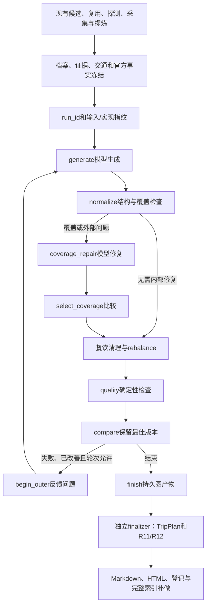

# TravelGuide 一期实现与验收

实现日期：2026-10-14；独立审查与交付核验：2026-10-15。范围：P0核对与回归、P1-A等价规则迁图、P1-B硬约束策略、持久恢复、调用预算与独立后处理。P2工具Agent、P3混合检索/重排不在本期。

## 实际业务与价值

城市攻略是可更新底稿；按当前需求生成候选，点位实体/资料时效命中免新采，未命中走探测与预算采集。评论、文案与口播按原文证据编号提炼和复核，来源/冲突与待确认信息继续向下游传递。规划根据地点档案与可用交通资料生成，代码做约束检查，有限修复只采纳允许的改进。没有有效资料的规则列为未知，不把缺资料当作全部满足。

本期解决的是准备好资料后规划失败、进程退出和后处理部分失败的续接，以及模型请求预算与轨迹核对。框架迁移本身不证明答案变好；成本下降、用户提升和真实事实准确率尚未测量。

## 真实架构



模型仅在generate、coverage_repair节点产出结构化规划。规范化、门禁、采纳、路由和后处理由代码执行。此图属于AI工作流；没有将它描述为自由选工具的Agent或多Agent。

## 代码落点

| 文件 | 用途 |
|---|---|
| core/planning_runs.py | run与输入快照、版本指纹、事件/响应账本、原子预算、OS锁、取消与后处理状态 |
| core/model_calls.py、core/llm.py | 规划专用SDK传输、关闭SDK重试/自动重定向、应用层重试、保存/复用响应与未知usage |
| pipeline/planning_graph.py | StateGraph及条件边、持久SqliteSaver、生成/检查/有限修复与采纳 |
| pipeline/planning_policy.py | 确认约束与稳定违反ID、已判定/未知覆盖、硬集合优先、旧加权对照 |
| pipeline/planner.py | 抽取纯提示构造；旧plan_itinerary保持可用，供回退与对照 |
| service/planning_flow.py | 独立finalizer、恢复调度与轮询状态，不依赖旧线程局部变量 |
| service/trip.py | 保存完整后处理输入并接入子图；保留原流程开关 |
| core/knowledge.py、vector_store.py、sqlite_utils.py、rag.py | 报告登记幂等、连接释放、逐片段检查及部分索引补齐 |
| api_server.py、web/index.html | 运行状态/恢复/取消接口、原轮询兼容与继续生成入口 |
| tests_planning.py、tests_planning_worker.py | 固定反例、真实SDK假传输、真实子进程退出/恢复、并发与业务出口回归 |
| evals/travelguide | 策略反例标签、结果与复现入口 |

P0已有引用补丁在根项目已合并。本期复用core/evidence.py、extract/verify、编号回填与版本化语料，并运行tests_evidence.py覆盖完整摘录、假后缀、输入范围、来源/快照、支持性及下游出口。没有重复替换或清理原缓存。支持性仍由模型辅助判断；原文存在、总结被支持和事实当前有效不是同一层。

## 两种策略与兼容变化

- legacy-v1：原内部覆盖修复逻辑；外层只有fail才回炉、最多原配置轮次，`2×fail+warn`严格变少才采纳；餐饮清理、rebalance、R11/R12定稿语义保留。
- hard-first-v1（默认）：新规划先满足格式/点位/天数契约；不能丢判定资料；新硬违反集必须是旧集合子集，严格缩小优先；集合相同才比较软问题，平局保留旧版。
- hard-first的内部覆盖修复也直接比较硬约束，不先用旧覆盖问题数量过滤。重复时段、全天与其他安排冲突均属契约无效；首个无效候选只保存为诊断，有限修复后没有合法候选就停止报错，不输出成功报告。
- 没有合法基线时允许接纳首个契约合法候选，仍如实披露其未解决硬冲突；不把空行程的少冲突当成优势。之后才比较两个合法版本的硬违反子集。
- 明确硬约束覆盖用户提交的excluded_spots、具有效期资料的闭馆日/开放时间冲突以及规划契约。自由文本偏好不自动升级为已确认硬条件。未解析的排除点名、缺日期/资料及过期资料明确未知；别名并非在此层自动确认为同一个地点。
- 过期官方资料在hard-first的QC视图中同样被排除，不借旧QC把未知资料重新变为强制闭馆修复指令；原始资料仍保留在快照及带时效标识的报告中。硬问题包含稳定ID、对象/日期/时段、快照路径引用、判定状态与修复提示；旧QC规则独立保留。

等价对照验证了固定响应下提示顺序、内外调用、规范化、修复采纳和餐饮处理，不声称任意线上输入输出完全一致。为保存完整快照，官方事实提前在图前读取；原热度UPSERT移至该边界前；报告名增加run后缀。这些是明确的兼容变化，非质量提升证据。

## 持久化、恢复与边界

数据位于`data/planning/runs.db`及`checkpoints.db`，OS锁在`data/planning/locks`。SQLite连接明确释放；run_id同时用作thread_id。OS锁持有图执行到后处理结束，进程退出自动释放；不会因租约计时到期抢占仍在发请求的线程。

输入冻结需求、候选/验证、资料与原文证据、景点/餐饮档案、摘要、来源/采集日期、攻略/草案、地图交通、官方事实、热度、漏斗、报告元信息及样本数量。字典原顺序也被保留，因为它影响提示词。原输入变更、快照篡改、实现/模板/检查点依赖版本变化或默认24小时过期都拒绝静默恢复，应复核后建立新run。

恢复方法：

1. 发起原`POST /api/trip`，开始规划后原任务轮询返回planning_run_id及planning状态。
2. `GET /api/planning-runs/{run_id}`查看节点、停止原因、检查结果/最佳规划、预算、是否可恢复及阻碍。
3. `POST /api/planning-runs/{run_id}/resume`返回202与原job_id，继续轮询`GET /api/jobs/{job_id}`。
4. `POST /api/planning-runs/{run_id}/cancel`或原任务取消接口持久取消。

新run不能靠resume改需求或重获预算。取消、实际请求被预算拒绝、致命模型配置错误、重试上限耗尽或有限修复后仍无合法规划不会自动恢复；缺Key等未发送情形可以配置后恢复原run。预算余额为零但有已保存响应/检查点时仍可恢复纯代码节点，确实需要新请求才拒绝，且不增配额。已有图产物的HTML/索引失败可补做。缺Embedding配置是明确跳过，不当作入库成功；配置可用后，在快照有效期与版本兼容范围内开放同run补索引。

规划恢复不进入_run_trip、不reset_session、不探测或采集、不重新调用地图。准备资料前的原采集流程未做进程恢复；整条采集仍用原进程级导航/风控机制，不能宣传全任务或所有用户完全隔离。

## 请求预算与失败语义

本期budget_scope为planning。默认12次实际模型HTTP发送尝试、每个语义调用最多3次应用尝试、外层回炉沿用1轮默认。它们是不同计数。SDK重试与自动重定向关闭；重定向端点作为配置错误处理。所有尝试在发送前持久原子预留，恢复不归零；零预算不创建客户端或发送请求。

响应成功保存后，图尚未保存也能按call_id和输入指纹复用。进程在外部响应返回前/写入前退出，原预留标unknown，重试仍耗一笔预算；不能承诺外部请求恰好一次。缺usage的输入/输出token字段保持null，汇总同时提供已知token与未知次数，不推算金额。

事件含run/node/call/attempt、输入哈希、模型、时间、状态、已知usage、错误类别和采纳原因，不保存请求header、Key或异常原文。response单独保存供恢复；API显示的是自己的本地任务数据，未新增多租户权限体系。

图外报告使用稳定run文件名，Markdown与HTML原子写出；已被外部修改的同名内容拒绝覆盖。登记按路径幂等；索引检查全部预期片段、补齐缺项，不能仅凭一个prefix判完成。每项后处理独立记录，报告可用与索引可用分别描述。

## 配置与回退

```dotenv
PLANNING_GRAPH_ENABLED=true
PLANNING_POLICY=hard-first-v1
PLANNING_MAX_HTTP_ATTEMPTS=12
PLANNING_SNAPSHOT_TTL=86400
```

新依赖为langgraph==1.2.15、langgraph-checkpoint-sqlite==3.1.2；在项目环境安装requirements。开启子图时，任务开始前检查依赖，避免采完才发现缺框架。既有Python/FastAPI/Pydantic、SQLite/可选FAISS、DrissionPage/HTTPX、高德、FastMCP/stdio、Jinja2及原生前端延续。

调试对照可改PLANNING_POLICY=legacy-v1。需回退整个规划迁移时设PLANNING_GRAPH_ENABLED=false并重启；旧流程仍在，不删除run/检查点或缓存。显式排除字段需要hard-first-v1，不能回退后悄悄忽略该条件。恢复老实现run也须核对实现指纹；旧历史报告没有变成新版本已验证报告。

## 验收与复现

运行`python tests_offline.py`：既有入口通过load_tests包含tests_evidence及tests_planning。CI原测试入口保持，该工作流代码已更新依赖；没有执行远程GitHub Actions，不能宣称此次CI已经全绿。

新的测试覆盖：内外调用等价、覆盖修复、真实闭馆反例修复；新增硬冲突/同数量替换/覆盖丢失；零预算、超时、非法JSON、致命鉴权、未知usage和持久重试上限；单run互斥、多run并发隔离和预算预留；生成/QC检查点子进程重启；响应已保存和未知窗口两类真实进程强制退出；原自动/指定点位入口到报告；取消及报告/登记/索引补做。

独立审查另外复现并修复了硬约束被旧覆盖门槛挡住、首次无效候选成为best、硬违反被标quality_complete、过期事实触发修复、重复槽位漏判以及余额为零阻断纯节点恢复。并补充并发建库迁移、清理失败仍释放OS锁、配置Embedding后补索引的回归；最终数量和原项目复验结果以交付验收日志为准。

固定策略反例：

```bash
python evals/travelguide/run_rules.py --output evals/travelguide/results.json
```

policy_cases.json为人工合成QC状态和硬违反集合，输出逐条输入指纹、标签依据、两种策略决定及理由。该评测无模型、无真实采集，不能将其正确案例数写成真实旅游准确率。tests_planning中的usage数值也是假传输返回的夹具，不是模型实耗或省token结论。

本次实际运行命令、环境和完整日志在交付目录的验收报告中记录。原测试中的2项条件跳过保持，未降低断言凑绿。真实LLM/端点兼容、浏览器采集与线上效果、Linux/Python3.11的远程CI仍待验证。

## 简历素材与面试案例

可以写“将准备资料后的规划、确定性检查与有限修复迁入LangGraph，采用SQLite检查点、冻结输入与独立后处理，实现阶段恢复”；恢复范围需讲清。

可以写“规划请求在发送前原子预留预算，关闭SDK重试，持久保存响应和调用账本；并发run分离用量，未知usage不算零”。不能据此写已测得token节省。

可以写“以稳定硬违反集合优先比较候选版本，防止减少软警告引入新闭馆冲突；固定反例、子进程恢复和原业务入口回归验证机制”。实际测试数量引用本次最终日志，不沿用旧AI生成的数字。

三个可复现案例分别对应tests_evidence的伪后缀/支持性反例、tests_planning的闭馆冲突与候选采纳、子进程响应保存/未知窗口恢复。这些是工程验证案例；支持性模型效果、真实旅游准确率与线上性能不能用它们替代。

个人贡献、简历措辞和效果数字由本人结合交付和实际参与确认，本期没有自动改简历PDF。后续P2再增加受控Function Calling工具循环，P3再单独对照检索增强。

框架设计参考：[LangGraph持久化](https://docs.langchain.com/oss/python/langgraph/persistence)、[检查点](https://docs.langchain.com/oss/python/langgraph/checkpointers)。本文描述上述本地实现及验证范围，不将文档机制当作项目效果证明。
